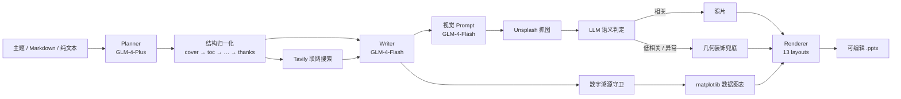

<div align="center">

# SmartPPT-AI

**输入一个主题，得到一份逻辑清晰、排版专业、可继续编辑的 16:9 演示文稿。**

从大纲规划、内容扩写、配图检索到版式渲染全部自动完成，并且对"编造数字"和"乱配图"保持零容忍。


</div>

---

## ✨ 亮点

- **LLM 动态大纲**：先规划"提出问题 → 分析原因 → 给出方案 → 结论总结"的分层结构，再逐页扩写；页数随主题复杂度在 12~26 页之间动态变化，最多 30 页。
- **防瞎编数字守卫**：`numeric_guard` 会逐条检查 bullet 中的百分比、年份、统计量，只有能追溯到草稿或联网资料的数字才会保留。
- **图片语义过滤**：LLM 先生成具象视觉 Prompt，Unsplash 抓图后再由评审模型判断相关性；低相关、判定异常、无图可用时统统弃图，改用几何色块排版。
- **matplotlib 动态图表**：页面包含可溯源的真实数据时，自动生成透明背景柱状图 / 折线图；LLM 全程不参与图表数据生成，没有真实数据就不出图。
- **本地图标库**：内置 37 个 Bootstrap Icons，按中文关键词自动匹配并栅格化到 256px，运行时零网络依赖；没有把握时宁可不放图标。
- **13 种专业布局**：封面、目录、章节、图文、双栏、图标网格、数据大字、引用、图表页、致谢等，配合渐变标题带、透明度层次与主题推导配色。
- **双入口**：CLI 与 Web 共用同一条流水线；Web 端通过 SSE 实时推送 6 步进度，生成完成后可直接下载。
- **完全可编辑**：输出为标准 `.pptx`，所有文字、形状、图片均为原生 PowerPoint 元素。

## 🚀 核心特性

| 能力 | 说明 |
|------|------|
| 大纲优先 | Planner 生成结构化大纲（封面 / 目录 / 章节 / 内容 / 总结 / 致谢），结构页由代码确定性补全，LLM 不掌控页码 |
| 内容扩写 | 每页 3~5 条 8~22 字短 bullet + 80~150 字演讲者注释，拒绝"Word 搬家" |
| 数字溯源 | 带单位数字必须能在草稿或联网资料中找到出处，否则整条 bullet 被替换 |
| 语义配图 | 具象英文视觉 Prompt → Unsplash → LLM 相关性评分（<60 弃图，异常也弃图） |
| 数据图表 | 单单位数据系列、2~8 个点、自动判定柱状 / 折线；照片页优先，图表只补无图页 |
| 图标系统 | 中文关键词匹配、最长命中优先、标题加权；cairosvg 栅格化 + 进程内缓存 |
| 视觉体系 | 6 套主题、主题色渐变、装饰圆透明度、卡片色主题推导、图片等比 contain 防拉伸 |
| 多输入 | 主题字符串、Markdown 文件、纯文本、Web 粘贴 / 上传 |
| 联网搜索 | Tavily 在"大纲前"和"逐页扩写前"两个节点注入真实资讯，可一键关闭 |

## 🏗️ 架构



核心链路可以概括为 **Planner → Writer → Renderer**：

1. **Planner**：主题 → 分层大纲（sections → pages），强模型优先，429 等异常时自动降级。
2. **结构归一化**：强制 `cover → toc → … → summary → thanks`，按可见章节页生成目录，执行 30 页硬顶。
3. **Search / Writer**：并发搜索页面资料，再由 Writer 扩写短 bullet 与演讲者注释。
4. **Visual**：视觉 Prompt → Unsplash → 语义判定 → 合格图片；无图页交给几何装饰布局。
5. **Chart**：仅对无照片、且含可溯源数字的内容页生成图表；渲染失败自动回退原布局。
6. **Renderer**：python-pptx 按 13 种布局合成渐变色块、图标、图片与图表，导出 `.pptx`。

## 📦 快速开始

### 环境要求

- Python **3.10+**（使用了 `X | Y` 类型标注）
- 可联网环境（调用 GLM / Unsplash / Tavily）
- `cairosvg` 需要系统 cairo 库；主流 Linux 与 WSL 通常已内置

### 1. 安装依赖

```bash
git clone git@github.com:wzjzzy2024/SmartPPT_AI.git
cd SmartPPT_AI
pip install -r requirements.txt
```

### 2. 配置密钥

```bash
cp .env.example .env
```

编辑 `.env`：

| 变量 | 是否必须 | 用途 |
|------|:---:|------|
| `GLM_API_KEY` | ✅ | 智谱开放平台，用于规划 / 扩写 / 翻译 / 图片评审 |
| `UNSPLASH_ACCESS_KEY` | ✅ | Unsplash 配图检索 |
| `TAVILY_API_KEY` | ⭕ | 联网搜索；缺失时自动降级为纯 AI 生成 |
| `TAVILY_SEARCH_ENABLED` | ⭕ | `1` 开启（默认）/ `0` 关闭 |
| `GLM_DEFAULT_MODEL` | ⭕ | 默认 `glm-4-flash` |
| `GLM_STRONG_MODEL` | ⭕ | 默认 `glm-4-plus` |
| `LLM_MAX_RETRIES` / `LLM_TIMEOUT` | ⭕ | 默认 `3` / `60` 秒 |

密钥申请地址：智谱 <https://open.bigmodel.cn> · Unsplash <https://unsplash.com/developers> · Tavily <https://tavily.com>

### 3. 运行

**Web 模式（推荐）**

```bash
cd ppt_agent
python server.py
# 打开 http://localhost:8000
```

**CLI 模式**

```bash
cd ppt_agent

python main.py "人工智能在医疗领域的应用"        # 主题生成
python main.py ../outline.md                     # 从 Markdown 生成
python main.py "校园低碳生活" --theme eco_nature  # 指定主题色
python main.py "AI 芯片" --search off            # 关闭联网搜索
python main.py                                   # 交互式输入
```

> Markdown 文件路径相对于当前执行目录；也可直接使用绝对路径。

### 4. Markdown 输入格式

```markdown
# 演示文稿标题

## 第一个内容页标题

### 要点一
### 要点二
### 要点三

## 第二个内容页标题

### 要点一
### 要点二
```

- 首个 `#` → 封面
- 后续 `#` → 章节分隔页
- `##` → 内容页
- `###` / 普通行 → 该页要点
- 封面、目录、总结、致谢由程序自动补全

## 🎨 主题色

| 主题 ID | 名称 | 适用场景 |
|---------|------|----------|
| `campus_academic` | 校园学术 | 学术报告、课程作业 |
| `business_report` | 商务汇报 | 企业汇报、商业计划 |
| `tech_creative` | 科技创意 | 技术分享、创新方案 |
| `eco_nature` | 环保自然 | 环保、生态、可持续 |
| `literature_art` | 文艺阅读 | 文化、艺术、历史哲学 |
| `minimal_general` | 简约通用 | 通用场景 |

不指定主题时会根据标题关键词自动匹配。

## 📁 项目结构

```text
SmartPPT-AI/
├── ppt_agent/
│   ├── main.py                  # CLI 入口
│   ├── server.py                # FastAPI + SSE Web 服务
│   ├── pipeline.py              # 统一生成流水线
│   ├── parser.py                # Markdown / 纯文本解析
│   ├── config.py                # 配置中心、主题色、布局映射
│   ├── search_config.py         # 联网搜索参数与开关
│   ├── index.html               # Web 前端
│   ├── agents/
│   │   ├── planner.py           # 主题 → 分层大纲
│   │   ├── writer.py            # 大纲 → 短 bullet + 备注
│   │   ├── translator.py        # 页面思想 → 视觉 Prompt
│   │   ├── image_fetcher.py     # Unsplash 检索
│   │   ├── image_judge.py       # 配图语义相关性判定
│   │   └── tavily_search.py     # Tavily 联网搜索
│   ├── engine/
│   │   ├── layout_engine.py     # 13 种布局的 Region 坐标
│   │   └── pptx_renderer.py     # 渐变 / 透明度 / 形状 / 图片原语
│   ├── templates/
│   │   └── slide_templates.py   # 13 种布局渲染器 + 分发
│   ├── assets/icons/            # 37 个本地 SVG 图标 + MIT 许可
│   └── utils/
│       ├── outline.py           # 结构归一化与页数上限
│       ├── numeric_guard.py     # 数字溯源守卫
│       ├── chart_builder.py     # 真实数据 → matplotlib 图表
│       ├── icon_matcher.py      # 中文关键词 → 图标
│       ├── json_parser.py       # 多策略 JSON 解析
│       └── font_size.py         # 自适应字号
├── output/                      # 生成的 PPTX（运行时创建，已忽略）
├── .env.example
├── requirements.txt
└── README.md
```

## 🛡️ 关键设计：宁可缺失，绝不编造

这个项目最重要的设计原则是 **fail-closed**：

| 环节 | 失败时的行为 |
|------|--------------|
| 数字溯源 | 无出处的数字所在 bullet 被剔除，用可信草稿补齐 |
| 图片相关性 | 评分低于 60、评审异常、无元数据 → 弃图，改用几何装饰布局 |
| 数据图表 | 数字无法溯源、单位混杂、数据点不足 → 不出图，保留原布局 |
| 图标匹配 | 没有足够置信的关键词命中 → 不放图标 |
| LLM 调用 | JSON 解析失败 / 接口异常 → 重试、降级模型，最终回退草稿要点 |
| 依赖缺失 | 未安装 matplotlib / cairosvg → 自动关闭图表 / 图标，主流程不中断 |

## 🔌 Web API

| 方法 | 路径 | 说明 |
|------|------|------|
| `GET` | `/` | Web 界面 |
| `GET` | `/api/themes` | 主题色列表 |
| `POST` | `/api/generate` | 提交生成任务，返回 `task_id` |
| `GET` | `/api/progress/{task_id}` | SSE 实时进度（`done` / `error` / `heartbeat`） |
| `GET` | `/api/download/{task_id}` | 下载生成好的 `.pptx` |

请求示例：

```json
{
  "topic": "人工智能在医疗领域的应用",
  "theme_id": "tech_creative",
  "search_enabled": true
}
```

Markdown 模式将 `topic` 换成 `markdown_text` 即可。

## ❓ 常见问题

**图表里的中文变成方块？**

`ppt_agent/config.py` 中的 `CJK_FONT_CANDIDATES` 默认适配 WSL（`/mnt/c/Windows/Fonts/simhei.ttf`）与 Linux 的 Droid Sans Fallback。macOS 建议安装 Noto Sans CJK SC / 思源黑体的 TTF/OTF，并把路径加入该列表（matplotlib 对 TTC 字体集合支持不稳定，优先使用单文件字体）。

**没有生成图表？**

图表只使用可溯源的真实数字，且要求同一单位至少 2 个数据点。联网关闭、资料中没有具体数字时不出图是预期行为。

**提示图标相关依赖缺失？**

安装 `cairosvg` 及系统 cairo 库即可；缺失时程序会自动跳过图标，不影响 PPT 生成。

**保存 PPTX 时报文件被占用？**

Windows 下若文件正被 PowerPoint 打开，程序会自动追加时间戳另存为副本。

**联网搜索失败会怎样？**

任何搜索异常都会静默降级为纯 AI 生成，不会中断主流程。

## 📜 License

本项目采用 [MIT License](LICENSE) 开源。

## 📄 第三方资源与许可

- 图标来自 [Bootstrap Icons v1.11.3](https://icons.getbootstrap.com/)，MIT License，全文见 `ppt_agent/assets/icons/LICENSE.txt`。
- 图表由 [matplotlib](https://matplotlib.org/) 渲染，SVG 栅格化由 [cairosvg](https://cairosvg.org/) 完成；二者均为运行时按需导入。
- 其余依赖及版本见 `requirements.txt`。

## 🔐 安全约定

- 所有 API 密钥仅存放于 `.env`，源码中不硬编码任何密钥。
- `.env`、`archive/`、`output/`、生成的 `.pptx` 与图片均已由 `.gitignore` 排除。
- 提交前请确认 `git status` 中不包含个人隐私材料或密钥文件。

---

<div align="center">

如果这个项目对你有帮助，欢迎点一个 ⭐ Star。

</div>
